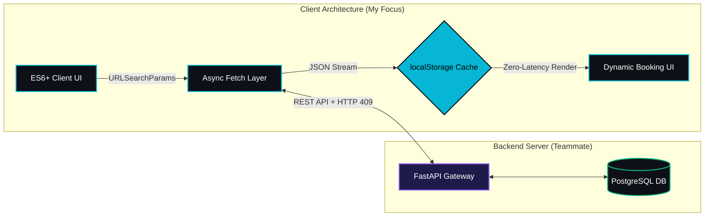
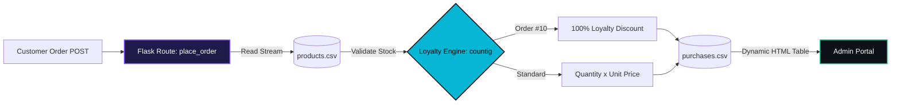
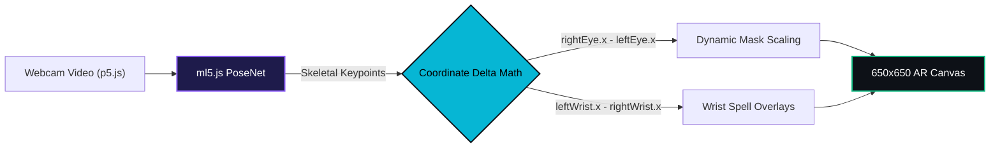
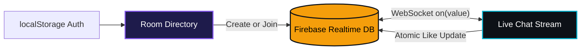

<div align="center">

<!-- DYNAMIC HEADER GRAPHIC -->


<!-- ANIMATED TYPING TAGLINE (URL-Encoded for 100% Reliability) -->
<a href="https://github.com/RD998">
  
</a>

<br/>

<!-- TELEMETRY PILLS -->


[](https://github.com/RD998)

<br/>

<!-- VISUAL TECH STACK ICONS -->
<a href="https://skillicons.dev">
  
</a>

</div>

---

### ⚡ System Telemetry // `whoami`

```yaml
entity: "Rachit Dheri (@RD998)"
tagline: "Non existent entity 🪦"
institution: "SRM Institute of Science and Technology"
core_arsenal:
  frontend_&_integration: ["JavaScript (ES6+)", "REST API Integration (fetch)", "localStorage State Caching", "HTML5/CSS3"]
  python_&_cloud:         ["Python", "Flask", "CSV Data Pipelines", "Firebase Realtime Database"]
  computer_vision_ar:     ["ml5.js (PoseNet)", "p5.js Canvas Engine", "Teachable Machine", "Real-Time Keypoint Math"]
```

---

### 🏗️ Interactive Project Blueprints
*Click on any module below to toggle its system architecture diagram.*

<details open>
<summary><b>🏥 01 // PATHFINDER — Client Architecture & API Integration Layer</b></summary>
<br/>

> **My Role (Frontend & API Integration):** Engineered the client-side web application and asynchronous data layer for a multi-page medical appointment platform (interfacing with a teammate's FastAPI/PostgreSQL backend). Built a custom `localStorage` state cache capable of storing 1,000+ time-slot payloads across page transitions with zero redundant network requests, alongside dynamic UI handling for `HTTP 409` waitlist conflicts.



- **My Stack:** `JavaScript (ES6+)` • `Async/Await fetch()` • `URLSearchParams` • `HTML5/CSS3`
- **Key Mechanics:** Multi-criteria accessibility filtering, real-time slot state locking, conflict-aware waitlist queuing, and Google Maps coordinate navigation.
</details>

<details open>
<summary><b>🧪 02 // EARTH CORE CHEMICALS — Flask ERP & Automated CSV Pipeline</b></summary>
<br/>

> **The Architecture:** A full-stack enterprise ordering and inventory portal built in **Python (Flask)**. Parses and mutates live `.csv` datasets (`products.csv` and `purchases.csv`) to validate stock availability, compute order totals, trigger an automated 10th-order loyalty discount (`countig`), and generate server-side HTML data tables for administrators.



- **Stack:** `Python` • `Flask` • `CSV File I/O` • `Jinja2 Templates` • `HTML5/CSS3`
</details>

<details>
<summary><b>👁️ 03 // Modified Filer app — Real-Time Computer Vision & Spatial Scaling</b></summary>
<br/>

> **The Architecture:** A browser-based Augmented Reality filter app built with **p5.js** and **ml5.js (PoseNet)**. Tracks 2D skeletal keypoints (`nose`, `leftEye`, `rightEye`, `leftWrist`, `rightWrist`) in real time and computes pixel coordinate deltas so superhero masks and wrist-mounted spell effects dynamically scale as the user moves toward or away from the webcam.



- **Stack:** `JavaScript` • `ml5.js (PoseNet)` • `p5.js` • `HTML5 Canvas`
</details>

<details>
<summary><b>💬 04 // QWITTER — Real-Time Cloud Social & Multi-Room Chat Platform</b></summary>
<br/>

> **The Architecture:** A live social messaging web app powered by **Google Firebase Realtime Database**. Uses persistent WebSocket listeners (`on('value')`) to synchronize room creation, stream live chat messages, and update post like counters instantaneously across connected clients.



- **Stack:** `JavaScript` • `Firebase Realtime Database` • `Bootstrap` • `HTML5/CSS3`
</details>

<details>
<summary><b>🌐 05 // FRONTEND UI & CIVIC-TECH SUITE — YouthVoice AI & Technesia G20</b></summary>
<br/>

- **YouthVoice AI:** A civic-awareness platform delivering interactive policy recommendations, custom `.parallax` scrolling effects, and viewport animations via **ScrollReveal.js**.
- **Technesia G20:** An interactive web portal featuring a live case-insensitive DOM card search engine (`searchWebsite()`), a custom programmatic DOM modal prompt backed by `sessionStorage`, and animated navigation drawers.
</details>

---

### 📈 Contribution Map & Live Activity Monitor

<div align="center">

<!-- 52-WEEK CONTRIBUTION HEATMAP -->


<br/><br/>

<!-- COMMIT STREAK TELEMETRY -->


<br/><br/>

<!-- REAL-TIME ACTIVITY MONITOR GRAPH -->
<!--  -->

</div>

---

<div align="center">
  
  <sub>Architected by <b>Rachit Dheri (@RD998)</b> • SRM IST</sub>
</div>
