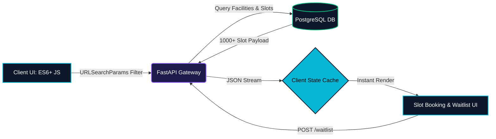
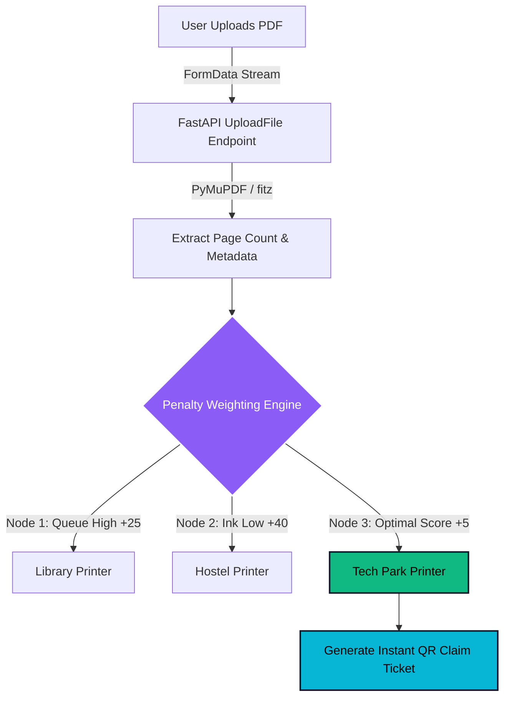
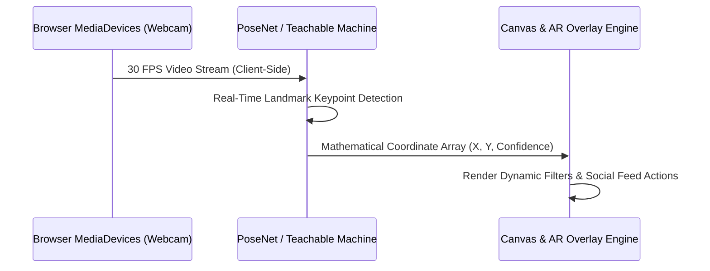

<div align="center">

<!-- DYNAMIC HEADER WAVE & BANNER -->


<!-- ANIMATED TYPING TAGLINE (Customize your exact GitHub tagline in the 'lines=' parameter below!) -->
<a href="https://github.com/RD998">
  
</a>

<br/>

<!-- STATUS & TELEMETRY PILLS -->


[](https://github.com/RD998)

</div>

---

### `whoami` // System Telemetry

```yaml
developer: "Rachit Dheri (@RD998)"
location: "SRM Institute of Science and Technology, KTR"
philosophy: "Don't just build static pages—engineer stateful, reactive systems that solve bottlenecks."
architecture_focus:
  - Full-Stack Web Applications (Vanilla JS ES6+, FastAPI, PostgreSQL, MongoDB)
  - Client-Side Machine Learning & AR (PoseNet, Teachable Machine, Web ML)
  - Algorithmic Load-Balancing & Scientific Computing (Python, Cheminformatics, CSV Pipelines)
currently_leveling_up: ["React", "TypeScript", "Docker & Containerization", "Event-Driven Systems"]
```

---

### 🛠️ Interactive Project Blueprints
*Click on any system module below to expand its live architecture diagram and technical breakdown.*

<details open>
<summary><b>🏥 01 // PATHFINDER — Healthcare Routing & Waitlist Engine</b> <i>(Click to toggle architecture)</i></summary>
<br/>

> **The Engineering Problem:** Standard appointment portals fail when schedules fill up and struggle with heavy multi-page payload transfers.  
> **The Solution:** A full-stack medical booking system featuring accessibility filtering, dynamic slot locks, an automated conflict-aware waitlist (`HTTP 409` handling), and a custom client-side `localStorage` state cache that eliminates redundant database reads across page transitions.



- **Stack:** `JavaScript (ES6+)` • `FastAPI` • `PostgreSQL` • `HTML5/CSS3` • `Render Cloud`
- **Key Mechanics:** Asynchronous `fetch()` orchestration, dynamic query parameterization, geolocation-linked navigation, and real-time waitlist state toggling.
</details>

<details>
<summary><b>🖨️ 02 // ECO-SPOOL — Smart Campus Algorithmic Print Load-Balancer</b> <i>(Click to toggle architecture)</i></summary>
<br/>

> **The Engineering Problem:** Campus printers suffer from massive physical queues and unexpected ink/paper depletion while nearby nodes sit idle.  
> **The Solution:** An IoT-simulated resource router that parses uploaded PDFs in memory, calculates hardware penalty weights across campus nodes, and issues cryptographic/QR claim tickets to route students to the optimal machine.



- **Stack:** `Python` • `FastAPI` • `PyMuPDF` • `JavaScript FormData API` • `QRCode.js`
</details>

<details>
<summary><b>👁️ 03 // VISION-SOCIAL SUITE — AR Snapchat & Twitter Clones</b> <i>(Click to toggle architecture)</i></summary>
<br/>

> **The Engineering Problem:** Running computer vision on a backend server introduces massive video latency and high cloud compute costs.  
> **The Solution:** Browser-based Augmented Reality and social platforms running real-time **Pose Estimation** and classification directly on the client's GPU/CPU via Web ML.



- **Stack:** `Vanilla JavaScript` • `PoseNet` • `Google Teachable Machine` • `WebRTC / MediaDevices API`
</details>

<details>
<summary><b>🧪 04 // ENTERPRISE DATA & COMPUTATIONAL SCIENCE — Earth Core & Cheminformatics</b> <i>(Click to toggle details)</i></summary>
<br/>

- **Earth Core Chemicals Web Utility:** Engineered a custom CSV data processing pipeline and web interface for parsing, structuring, and filtering enterprise chemical datasets.
- **Ammonia Synthesis & Cheminformatics Lab:** Developed Python-based computational models for a **Gibbs Reactor (Ammonia Synthesis)** alongside **SMILES molecular structure parsing** and property visualization scripts.
- **AI Tools Directory & Mobile Suite:** Built curated AI competition platforms and cross-platform mobile utilities using **Thunkable**.
</details>

---

### ⚡ The Technical Arsenal

<div align="center">

| Architectural Layer | Technologies & Tooling |
| :--- | :--- |
| **Frontend & Web ML** |  <br/> *ES6+ DOM Manipulation, Async Fetch, PoseNet, Teachable Machine* |
| **Backend & Data Pipelines** |  <br/> *REST APIs, Algorithmic Routing, CSV Pipelines, Scientific Computing* |
| **DevOps, Security & IDEs** |  <br/> *Git Workflows, Snyk Security, Render Deployment* |

</div>

---

### 📊 Live GitHub Telemetry & Contribution Matrix

<div align="center">
  
  
</div>

<div align="center">
  
</div>

---

<div align="center">
  
</div>
