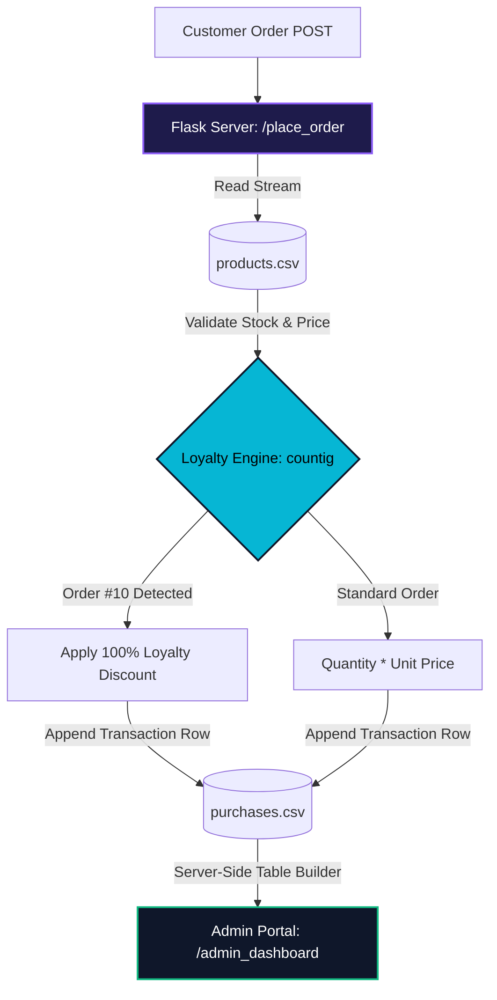
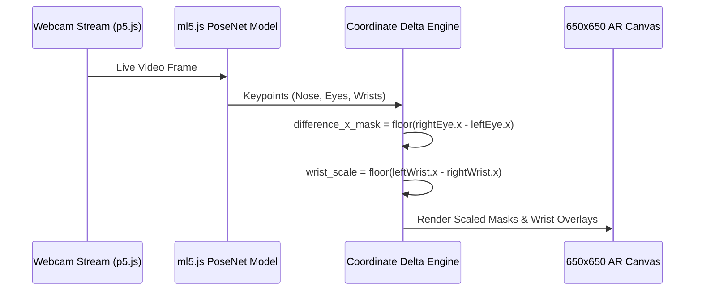

<div align="center">

```
╔══════════════════════════════════════════════════════════════════════════════════╗
║  RACHIT DHERI // @RD998                                                          ║
║  > "Non existent entity 🪦"                                                      ║
║  > Frontend Engineering • Browser-Based Computer Vision • Python Data Pipelines  ║
╚══════════════════════════════════════════════════════════════════════════════════╝
```


[](https://github.com/RD998)

</div>

---

### ⚡ System Telemetry // `whoami`

```yaml
entity: "Rachit Dheri (@RD998)"
status: "Non existent entity 🪦 // Building real-world software"
institution: "SRM Institute of Science and Technology"
core_competencies:
  frontend_&_integration: ["JavaScript (ES6+)", "REST API Consumption (fetch)", "DOM State Caching", "HTML5/CSS3"]
  python_&_backends:      ["Python", "Flask", "CSV Data Pipelines", "Firebase RTDB"]
  computer_vision_ar:     ["ml5.js (PoseNet)", "p5.js Canvas Engine", "Teachable Machine", "Real-Time Keypoint Math"]
```

---

### 🏗️ Featured Systems Architecture (Click to Expand Blueprints)

<details open>
<summary><b>🏥 01 // PATHFINDER — Client Architecture & API Integration</b></summary>
<br/>

> **My Contribution (Frontend & Integration):** Engineered the client-side architecture for a multi-page medical booking platform. While a teammate developed the FastAPI/PostgreSQL backend, I built the JavaScript (ES6+) integration layer to consume those REST endpoints. To handle massive 1,000+ time-slot payloads across page transitions without redundant network calls, I designed a custom `localStorage` state cache, paired with an asynchronous UI that dynamically handles `HTTP 409` waitlist conflicts.

```mermaid
graph LR
    subgraph Client Architecture (My Focus)
    UI[ES6+ Client UI] -->|URLSearchParams| FETCH(Async Fetch Layer)
    FETCH -->|JSON Stream| CACHE{localStorage State Cache}
    CACHE -->|Zero-Latency Render| BOOK[Dynamic Booking UI]
    end
    
    subgraph Server (Teammate)
    FETCH <-->|REST API| API(FastAPI Backend)
    API <--> DB[(PostgreSQL)]
    end
    
    style UI fill:#0f172a,stroke:#06b6d4,stroke-width:2px,color:#fff
    style FETCH fill:#0f172a,stroke:#06b6d4,stroke-width:2px,color:#fff
    style CACHE fill:#06b6d4,stroke:#0f172a,stroke-width:2px,color:#000
    style BOOK fill:#0f172a,stroke:#06b6d4,stroke-width:2px,color:#fff
    style API fill:#1e1b4b,stroke:#8b5cf6,stroke-width:2px,color:#fff
```

- **My Tech Stack:** `JavaScript (ES6+)` • `Asynchronous fetch()` • `DOM Manipulation` • `HTML5/CSS3`
- **Key Features:** Multi-criteria accessibility query building, dynamic slot state toggling, and zero-latency page transitions via client-side caching.
</details>

<details open>
<summary><b>🧪 02 // EARTH CORE CHEMICALS — Flask ERP & Automated CSV Data Pipeline</b></summary>
<br/>

> **The Architecture:** A full-stack enterprise ordering and inventory management system built entirely with **Python (Flask)**. Reads and mutates raw `.csv` datasets (`products.csv` and `purchases.csv`) on the fly to validate stock quantities, compute order pricing, apply an automated customer loyalty algorithm, and render dynamic HTML data tables for administrators.



- **Tech Stack:** `Python` • `Flask` • `CSV File I/O Pipelines` • `Jinja2 Templates` • `HTML5/CSS3`
- **Key Features:** Role-separated Customer and Admin portals, real-time stock threshold validation, and automated 10th-order loyalty rewards.
</details>

<details>
<summary><b>👁️ 03 // AR POSENET ENGINE — Real-Time Computer Vision & Dynamic Scaling Filter</b></summary>
<br/>

> **The Architecture:** A browser-based Augmented Reality camera application using **p5.js** and **ml5.js (PoseNet)**. Instead of static overlays, the engine tracks 2D skeletal keypoints (`nose`, `leftEye`, `rightEye`, `leftWrist`, `rightWrist`) at 30 FPS and calculates real-time pixel deltas to dynamically scale masks and wrist-mounted spell effects as the user moves in 3D space.



- **Tech Stack:** `JavaScript` • `ml5.js (PoseNet)` • `p5.js` • `HTML5 Canvas`
</details>

<details>
<summary><b>💬 04 // QWITTER — Real-Time Cloud Social & Chat Room Platform</b></summary>
<br/>

> **The Architecture:** A real-time multi-room messaging platform powered by **Google Firebase Realtime Database**. Uses persistent WebSocket listeners (`on('value')`) to synchronize new chat rooms, broadcast live messages, and increment post likes across all active browsers without refreshing the page.

- **Tech Stack:** `JavaScript` • `Firebase Realtime Database` • `Bootstrap` • `HTML5/CSS3`
</details>

<details>
<summary><b>🌐 05 // FRONTEND UI & CIVIC-TECH SUITE — YouthVoice AI & Technesia G20</b></summary>
<br/>

- **YouthVoice AI:** A civic-engagement platform designed to boost youth participation in governance through interactive policy recommendation workflows, custom `.parallax` scrolling mechanics, and viewport animations via **ScrollReveal.js**.
- **Technesia G20:** An interactive web portal featuring a live case-insensitive DOM card search filter, a programmatic custom modal prompt backed by `sessionStorage`, and animated collapsible navigation drawers.
</details>

---

### 🧰 Technical Matrix

| Layer | Core Technologies | Applied Engineering Concepts |
| :--- | :--- | :--- |
| **Frontend Integration** | `JavaScript (ES6+)` `HTML5/CSS3` `Bootstrap` | Asynchronous `fetch()`, REST API Consumption, Client-Side State Caching (`localStorage`) |
| **Python Ecosystem** | `Python` `Flask` | Server-Side Rendering, CSV Data Pipeline I/O, Backend Algorithmic Logic |
| **Databases & Cloud** | `Firebase RTDB` `Storage API` | Real-Time WebSocket Listeners, NoSQL Cloud Sync |
| **AI & Computer Vision** | `ml5.js` `PoseNet` `p5.js` | Real-Time Skeletal Landmark Tracking, Euclidean Scaling Math, Client-Side Web ML |

---

<div align="center">
  <sub>Built and architected by <b>Rachit Dheri (@RD998)</b> • SRM IST</sub>
</div>
