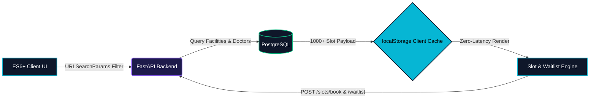
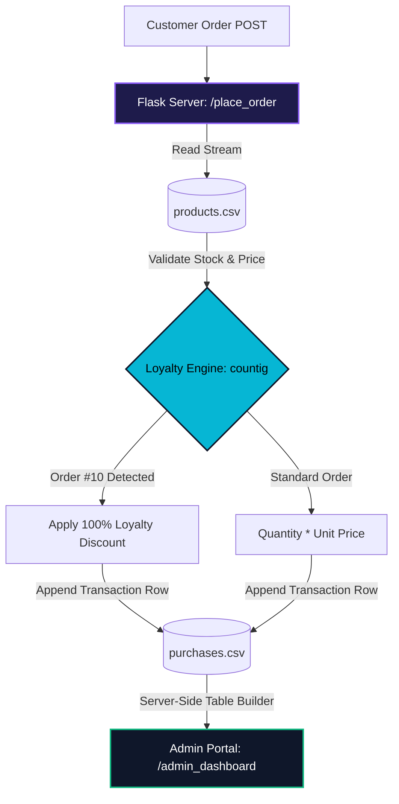
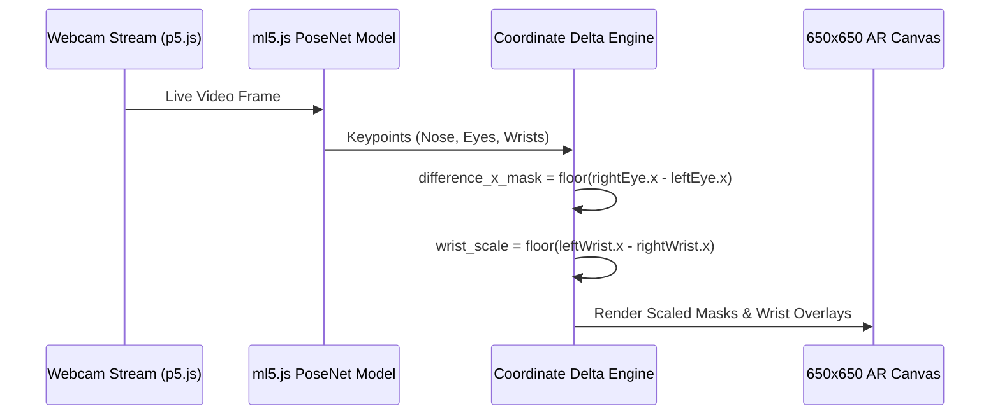
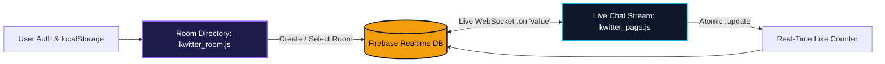

<div align="center">

```
╔══════════════════════════════════════════════════════════════════════════════════╗
║  RACHIT DHERI // @RD998                                                          ║
║  > "Non existent entity 🪦"                                                      ║
║  > Full-Stack Web Engineering • Browser-Based Computer Vision • Data Pipelines   ║
╚══════════════════════════════════════════════════════════════════════════════════╝
```


[](https://github.com/RD998)

</div>

---

### ⚡ System Telemetry // `whoami`

```yaml
entity: "Rachit Dheri (@RD998)"
status: "Non existent entity 🪦 // Building real-world software"
institution: "SRM Institute of Science and Technology"
core_competencies:
  backend_&_databases: ["Python", "FastAPI", "Flask", "PostgreSQL", "Firebase RTDB", "CSV Data Pipelines"]
  frontend_&_ui:       ["JavaScript (ES6+)", "HTML5 / CSS3", "DOM State Caching", "Bootstrap", "ScrollReveal.js"]
  computer_vision_ar:  ["ml5.js (PoseNet)", "p5.js Canvas Engine", "Teachable Machine", "Real-Time Keypoint Math"]
```

---

### 🏗️ Featured Systems Architecture (Click to Expand Blueprints)

<details open>
<summary><b>🏥 01 // PATHFINDER — Healthcare Routing & Conflict-Aware Waitlist Engine</b></summary>
<br/>

> **The Architecture:** A multi-page medical appointment platform backed by **FastAPI** and **PostgreSQL**. Engineered a client-side state cache using `localStorage` to handle 1,000+ time-slot payloads across page transitions with zero redundant network calls, paired with an automated waitlist system that catches `HTTP 409` slot conflicts.



- **Tech Stack:** `JavaScript (ES6+)` • `FastAPI` • `PostgreSQL` • `REST APIs` • `Google Maps URL API`
- **Key Features:** Multi-criteria accessibility filtering, dynamic slot disabling, live appointment cancellation, and automated waitlist queuing.
</details>

<details open>
<summary><b>🧪 02 // EARTH CORE CHEMICALS — Flask ERP & Automated CSV Data Pipeline</b></summary>
<br/>

> **The Architecture:** A full-stack enterprise ordering and inventory management system built with **Python (Flask)**. Reads and mutates raw `.csv` datasets (`products.csv` and `purchases.csv`) on the fly to validate stock quantities, compute order pricing, apply an automated customer loyalty algorithm, and render dynamic HTML data tables for administrators.



- **Tech Stack:** `Python` • `Flask` • `CSV File I/O Pipelines` • `Jinja2 Templates` • `HTML5/CSS3`
- **Key Features:** Role-separated Customer and Admin portals, real-time stock threshold validation, automated 10th-order loyalty rewards, and dynamic server-side table generation.
</details>

<details>
<summary><b>👁️ 03 // AR POSENET ENGINE — Real-Time Computer Vision & Dynamic Scaling Filter</b></summary>
<br/>

> **The Architecture:** A browser-based Augmented Reality camera application using **p5.js** and **ml5.js (PoseNet)**. Instead of static overlays, the engine tracks 2D skeletal keypoints (`nose`, `leftEye`, `rightEye`, `leftWrist`, `rightWrist`) at 30 FPS and calculates real-time pixel deltas to dynamically scale masks and wrist-mounted spell effects as the user moves in 3D space.



- **Tech Stack:** `JavaScript` • `ml5.js (PoseNet)` • `p5.js` • `HTML5 Canvas`
- **Key Features:** Client-side machine learning inference, real-time eye-distance and wrist-distance spatial scaling, multi-filter state cycling, and instant canvas snapshot export (`save1()`).
</details>

<details>
<summary><b>💬 04 // QWITTER — Real-Time Cloud Social & Chat Room Platform</b></summary>
<br/>

> **The Architecture:** A real-time multi-room messaging platform powered by **Google Firebase Realtime Database**. Uses persistent WebSocket listeners (`on('value')`) to synchronize new chat rooms, broadcast live messages, and increment post likes across all active browsers without refreshing the page.



- **Tech Stack:** `JavaScript` • `Firebase Realtime Database` • `Bootstrap` • `HTML5/CSS3`
</details>

<details>
<summary><b>🌐 05 // FRONTEND UI & CIVIC-TECH SUITE — YouthVoice AI & Technesia G20</b></summary>
<br/>

- **YouthVoice AI:** A civic-engagement platform designed to boost youth participation in governance through interactive policy recommendation workflows, custom `.parallax` scrolling mechanics, and viewport animations via **ScrollReveal.js**.
- **Technesia G20:** An interactive web portal featuring a live case-insensitive DOM card search filter (`searchWebsite()`), a programmatic custom modal prompt (`showCustomPrompt()`) backed by `sessionStorage`, and animated collapsible navigation drawers.
</details>

---

### 🧰 Technical Matrix

| Layer | Core Technologies | Applied Engineering Concepts |
| :--- | :--- | :--- |
| **Backend & APIs** | `Python` `FastAPI` `Flask` | REST Endpoint Design, Server-Side Rendering, Waitlist Conflict Handling (`HTTP 409`), CSV I/O |
| **Databases & State** | `PostgreSQL` `Firebase RTDB` `Storage API` | Relational Schemas, Real-Time WebSocket Listeners, Client-Side Caching (`localStorage` / `sessionStorage`) |
| **Frontend & UI** | `JavaScript (ES6+)` `HTML5` `CSS3` `Bootstrap` | Asynchronous `fetch()`, `URLSearchParams`, Dynamic DOM Injection, ScrollReveal & Parallax |
| **AI & Computer Vision** | `ml5.js` `PoseNet` `p5.js` `Teachable Machine` | Real-Time Skeletal Landmark Tracking, Euclidean Scaling Math, Client-Side Web ML |

---

<div align="center">
  <sub>Built and architected by <b>Rachit Dheri (@RD998)</b> • SRM IST</sub>
</div>
